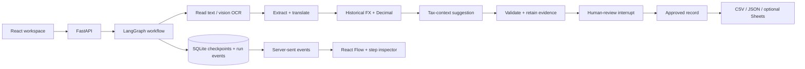

# Beleg: German Tax Document Review

**Turn documents into reviewable German tax records with the workflow visible.**

[Explore the public demo](https://mantakamahir.github.io/belegflow/) · [Run Beleg locally](#quick-start) · [Read the architecture](#architecture)

Beleg is a local-first, open-source application for German tax document intake,
translation, structured extraction, historical EUR conversion, and suggested tax
classification. It replaces an existing n8n automation with a Python execution
pipeline and an interactive React workspace. **n8n is not required.**

Use the built-in demo without credentials, or connect an OpenAI-compatible API to
process your own documents. Both modes use the same execution, validation,
checkpoint, review, and export code.

> **Scope:** a single-operator local application, not a tax adviser or a hardened
> internet-facing SaaS. Human approval is required before export. This project
> does not claim tax-law compliance, calibrated AI confidence, or audited accuracy.

The public demo is a browser-only walkthrough of three fictional examples. It
shows original text, German translations, currency conversion, and review
evidence without a login, API calls, or a running backend. The full workbench
runs locally and is the place to try approvals, export, and live processing.

## What you can do

- Upload PDF, PNG, JPEG, UTF-8 TXT, or EML files containing supported attachments.
- Extract digital PDF text locally; use vision OCR for scanned pages and images.
- Translate source content to German while preserving original financial values.
- Extract typed document facts and suggest a German income category with source evidence.
- Convert original amounts and withholding to EUR using historical reference rates
  and decimal arithmetic, with the rate and effective date preserved.
- Inspect the real workflow graph, individual step outputs, and measured durations.
- Correct key fields, add a review note, approve, then download CSV or JSON.
- Optionally import Google Drive/Gmail documents and explicitly export approved
  live records to Google Sheets.
- Resume from persisted checkpoints and deduplicate live intake by content hash.

## Quick start

### Option A: Docker

Install Docker with Compose, then:

```bash
git clone https://github.com/MantakaMahir/belegflow.git
cd belegflow
docker compose up --build
```

Open **http://localhost:8000**. No `.env`, API key, database account, or cloud
deployment is needed for the demo. The first build downloads dependencies;
subsequent demo use does not call external services.

Documents and checkpoints persist in the `belegflow-data` Docker volume. Stop the
application with `docker compose down`; this does not delete the volume.

### Option B: Python + Node.js

Requirements: **Python 3.11+**, **Node.js 22.12+**, and
[uv](https://docs.astral.sh/uv/getting-started/installation/).

```bash
git clone https://github.com/MantakaMahir/belegflow.git
cd belegflow
uv sync --frozen
npm ci --prefix web
npm run build --prefix web
uv run uvicorn app.main:create_app --factory --host 127.0.0.1 --port 8000
```

Open **http://localhost:8000**. The Python server serves the built frontend and API
from one origin. If the port is occupied, choose another port in this command.

For frontend development, run `npm run dev --prefix web` in another terminal.
Vite serves the interface on port 5173 and proxies `/api` to port 8000.

## Try the local demo

The workspace creates three fictional examples on first startup:

| Example | What it demonstrates |
| --- | --- |
| Northstar dividend | English → German, USD → EUR, withholding, review and export |
| Studio West invoice | German source, EUR identity conversion, uncertain issuer/recipient role |
| Incomplete travel receipt | Missing date and ambiguous `$`; approval blocked until corrected |

1. Open a document in **Document inbox**.
2. Compare **Original** and **German translation**.
3. Open **Workflow** and select a node to inspect its persisted output.
4. Review the record; use **Edit fields** where needed.
5. Approve the document and download CSV or JSON.

The demo's AI responses and non-EUR rate are fixtures, clearly labeled in the
interface. The calculations, data validation, SQLite writes, LangGraph interrupt,
review approval, and exports actually execute. Demo duration is **not** a live-AI
performance benchmark. Demo mode cannot upload arbitrary files or write to Google.

The demo is stateful: reopening a sample returns the same local record rather
than creating duplicates. Use a fresh `DATA_DIR` for a clean walkthrough.

## Enable live processing

Copy `.env.example` to `.env`:

```bash
# macOS / Linux
cp .env.example .env
```

```powershell
# Windows PowerShell
Copy-Item .env.example .env
```

Set your own credentials:

```dotenv
OPENAI_API_KEY=your-own-key
OPENAI_BASE_URL=https://freellm.gotiq.co/v1
OPENAI_MODEL=auto
```

Restart the backend, select **Live**, and upload a document. Other
OpenAI-compatible endpoints are supported by changing `OPENAI_BASE_URL` and
`OPENAI_MODEL`; actual compatibility depends on their chat-completions and model
capabilities. No subscription to this software is required; providers may charge for use.

The application requests JSON, validates it against Pydantic models, and permits
one schema-repair attempt. It does not assume every compatible proxy supports
OpenAI's strict JSON-schema response mode. Text documents need a text-capable
model; scanned PDFs and images additionally require **vision support** behind
the configured model. `auto` routing does not guarantee that support.

### Configuration

| Variable | Default | Purpose |
| --- | --- | --- |
| `OPENAI_API_KEY` | empty | Backend-only provider credential |
| `OPENAI_BASE_URL` | `https://freellm.gotiq.co/v1` | OpenAI-compatible API base URL |
| `OPENAI_MODEL` | `auto` | Model or provider routing alias |
| `DATA_DIR` | `data` | Local originals, records, events, and checkpoints |
| `SEED_DEMO` | `true` | Create fictional examples on startup |
| `MAX_UPLOAD_BYTES` | `15728640` | Upload limit, 15 MB |
| `MAX_PAGES` | `10` | Maximum PDF page count; excess pages are rejected, not silently omitted |
| `GOOGLE_CREDENTIALS_FILE` | empty | Trusted local Google credential file |
| `GOOGLE_DRIVE_FOLDER_ID` | empty | Drive folder for explicit imports |
| `GOOGLE_SHEET_ID` | empty | Spreadsheet for explicit exports |
| `GOOGLE_SHEET_RANGE` | `Sheet1!A:Y` | Destination range, 25 columns |

Docker Compose forwards the three AI settings from your shell or `.env`.
For Google connectors, mount your credential file read-only and add the relevant
Google environment settings to a local Compose override. Do not bake credentials
into the image or commit the override containing them.

## Optional Google integrations

Google services are optional. Uploads and local CSV/JSON exports work without them.

1. Enable the needed Google Drive, Gmail, or Sheets APIs in your own Google project.
2. Obtain **authorized-user OAuth credentials**, or a service-account credential
   for resources explicitly shared with that service account.
3. Store the trusted credential file outside the repository, or under ignored
   `secrets/`, and set `GOOGLE_CREDENTIALS_FILE` to its local path.
4. Configure the Drive folder or sheet ID and restart.
5. Use **Connections & setup** to import at most five recent items per UI action.

Scopes used by the corresponding action:

```text
https://www.googleapis.com/auth/drive.readonly
https://www.googleapis.com/auth/gmail.readonly
https://www.googleapis.com/auth/spreadsheets
```

Gmail requires user authorization; an ordinary service account cannot read a
personal Gmail inbox. The app consumes existing trusted credentials—it does not
implement a browser OAuth consent/onboarding flow. Never upload a credential
configuration from an untrusted source.

Prepare your sheet's first row in the order documented in `app/exports.py`.
The CSV uses those same bilingual column names. The legacy confidence column
contains **"Human reviewed; no calibrated confidence score"**, not an invented
probability. The legacy FX column contains the actual conversion rate, with
effective-date provenance available in JSON.

Google imports are manual, not scheduled polling. A file is deduplicated by its
SHA-256 content hash. Google Sheets exports are explicit and use RAW values. If a
write times out ambiguously, the app blocks another automatic attempt: inspect
the destination sheet before retrying manually. This is not an exactly-once
distributed delivery guarantee.

## Architecture

The public site and the local workbench share the fictional fixtures in
[`app/demo.py`](app/demo.py) and the EUR rounding function in
[`app/money.py`](app/money.py). The public build renders them into static files and
publishes only that output to GitHub Pages. The pipeline below runs in the local
workbench. See [`deploy/README.md`](deploy/README.md) for the static build and hosting.



### Why these choices

- **FastAPI + Pydantic:** explicit input/output contracts, validation at boundaries,
  API documentation at `/docs`, and a small Python backend.
- **LangGraph:** a real checkpointed review interrupt and inspectable state. The
  graph is written in code, not a generic JSON executor or a no-code editor.
- **React Flow:** visualizes the graph returned by the backend. Execution events,
  not frontend timers, determine node status. The canvas is lazy-loaded.
- **SQLite and local files:** no database service is needed to try or inspect the
  product. A single local worker bounds resource use and respects PDFium's
  threading restrictions.
- **Native controls and plain CSS:** no additional form, state-management,
  animation, or component framework is needed for this scope.

The OpenAI SDK handles bounded transport retries (two retries, 90-second request
timeout). Failed runs can resume from their persisted checkpoint. This local
worker is not a distributed task queue: it does not promise uninterrupted
execution across machine loss, automated failover, or multi-worker coordination.

### Financial integrity

- Keep source amounts and translated text separately; never rewrite the original
  amount before extraction.
- Use `Decimal` and half-up rounding to two EUR decimals, not model arithmetic or
  floating-point multiplication.
- Fetch a historical rate for the document date and retain both requested and
  effective dates. A weekend/holiday rate may refer to an earlier working day.
- Never assume `$` means USD without context, invent a missing date, or use a
  current rate as a historical substitute.
- Missing/unsupported rates block approval; corrections recompute the conversion.
- Classification is a suggestion, not a legal conclusion. Exact source evidence
  is checked against the extracted text; unsupported quotations are excluded.

## Tests and checks

```bash
uv sync --frozen
uv run pytest -q
uv run ruff check app tests
npm ci --prefix web
npm run build --prefix web
```

Browser checks:

```bash
cd web
npx playwright install chromium
npm run test:e2e
```

The browser suite starts an isolated no-key backend on port 8019 and stores its
data in ignored `data/e2e`. Build the frontend before running it. To test a server
you started yourself, set `BASE_URL` instead.

Local visual-review captures are saved under `.impeccable/review/`; the directory
is ignored by Git because these screenshots are inspection artifacts, not product assets.

Tests cover no-network demo execution, required-field failures, currency math,
historical-rate request construction, duplicate intake, review persistence across
restart, export gating, spreadsheet-formula protection, file/email parsing, origin
and host boundaries, and the desktop/mobile product journey. Google account
permissions and provider-specific vision compatibility need integration checks
with your own accounts; deterministic tests do not prove those integrations.

CI runs Python checks, frontend type/build checks, and the no-key browser suite.
No API secrets are required for CI.

## Privacy and security

- `.env`, credential files, local documents, databases, and build artifacts are
  excluded from Git. `.env.example` contains no secrets.
- API keys are only used by the backend and are not exposed by `/api/config`.
- Demo execution does not contact AI, FX, or Google services.
- **Live processing sends source content to your configured AI provider.** Check
  that provider's retention, privacy, and geographic processing policies before
  using sensitive documents. FX requests send date/currency, not document text.
- The app binds to loopback by default. Host checks, same-origin write checks,
  streaming request/upload bounds, POSIX owner-only local-data permissions, and
  spreadsheet-formula escaping reduce common local risks.
- There is **no application login, tenant isolation, at-rest encryption, malware
  sandbox, or compliance certification**. Other users/processes on your machine
  may access the local service or its files. Do not expose it through a public
  tunnel or bind it to an untrusted network without adding appropriate security.
- Originals, extracted text, node outputs, and checkpoints are stored locally.
  Choose an encrypted disk and retention policy appropriate to your data. To
  remove records, stop the app and remove only the dedicated data directory or
  Docker volume you intentionally created for it.

Read [SECURITY.md](SECURITY.md) before using real financial documents.

## Project layout

```text
app/
  main.py          API, upload boundary, SSE, local frontend serving
  workflow.py      Code-defined graph, review interrupt, local worker
  providers.py     OpenAI-compatible AI and historical FX
  documents.py     File validation, PDF/text/image reading, EML attachments
  models.py        Validated document, classification, and review contracts
  store.py         SQLite run/event persistence
  exports.py       Bilingual CSV mapping and formula protection
  google.py        Optional Drive, Gmail, and Sheets operations
  demo.py          Fictional source text and prepared responses
web/src/           React workspace and lazy-loaded workflow inspector
tests/             Backend behavior and security-boundary checks
web/tests/         Browser product-journey checks
```

## From n8n to code

The original automation used Google Drive intake, Gemini OCR, translation and FX
tools, extraction and tax agents, merge/cleanup nodes, and Google Sheets output.
Its Gmail branch was disabled. This application preserves the use case rather
than reproducing every node mechanically:

| Original automation | Beleg |
| --- | --- |
| Drive trigger + binary/base64 nodes | Upload/EML intake and explicit optional Google import |
| Gemini OCR HTTP request | Local text extraction plus compatible vision calls |
| Translation agent + calculator + free-form FX URL tool | Typed extraction, fixed-host FX lookup, deterministic arithmetic |
| Multiple structured parsers | Pydantic contracts and one bounded repair attempt |
| Tax agent | Classification with checked source evidence and review warnings |
| Merge + final cleanup agent | Typed deterministic composition; no extra cleanup LLM call |
| Append sheet | Approval-gated CSV/JSON and explicit optional Sheets export |

Client credentials, identifiers, real documents, and the original workflow JSON
are deliberately **not included**.

## Limitations

- German tax categories are broad suggestions; no tax return is filed or computed.
- No OCR accuracy or tax-classification accuracy benchmark has been established.
- OCR is not layout-faithful document reconstruction. The preview shows extracted
  text, not a pixel-perfect PDF viewer.
- Tables, multiple currencies, complex multi-transaction bank statements, and
  multiple tax periods may require splitting into separate records and human
  verification. One record currently represents one primary amount/currency.
- Digital PDFs over 10 pages, documents over 15 MB, images over 20 megapixels, and
  text over 60,000 characters are rejected rather than silently truncated.
- No DOCX, XLSX, MSG, audio/video intake, automatic email sending, or scheduler.
- Review edits cover primary identity, amount/currency/date, category, party and
  purpose; this is not a full financial-ledger editor.
- SQLite/local worker intentionally target one trusted operator. Add a durable
  job service, access control, storage isolation, observability, and load testing
  before evolving this into a hosted product.

## License

[MIT](LICENSE). Third-party services and dependencies have their own terms.

Built by [Mantaka Mahir](https://mantakamahir.github.io/).
